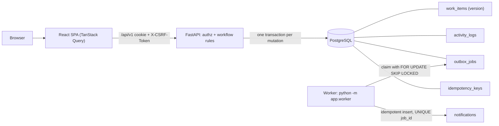

# Architecture

## Transaction boundaries
* Every mutation (create, edit, assign/claim, transition, comment) is **one database transaction** containing: the guarded state change, its `activity_logs` row(s), the `outbox_jobs` row (for assignments) and, for creation, the `idempotency_keys` row. Any failure rolls all of them back, so there are never audit rows for changes that did not happen, nor jobs for changes that rolled back.
* **Version guard:** `UPDATE work_items SET …, version = version + 1 WHERE id = :id AND version = :expected`. Zero rows → 409 with the current record; nothing is written (the activity insert comes *after* the successful guarded update).
* **Claim:** `UPDATE … WHERE id = :id AND assignee_id IS NULL`. PostgreSQL row locking serialises competing claims; the loser re-evaluates the predicate after the winner commits, matches 0 rows, and gets 409.
* **Idempotent create:** `INSERT … ON CONFLICT (user_id, key) DO NOTHING` runs in the same transaction as the item insert. A concurrent duplicate blocks on the unique index until the first transaction commits, then reads the stored result (same fingerprint → replay, `Idempotent-Replay: true`, HTTP 200; different payload → 409). If the first attempt fails or is rejected before inserting, nothing is stored and the key stays reusable.

## Outbox worker
Jobs: `pending → processing → done`, or back to `pending` with exponential backoff (2, 4, 8, 16 s … cap 5 min) on failure, and `dead` after 5 attempts. `processing` jobs whose lock is older than 60 s are reclaimable (crash recovery). Delivery is at-least-once; the handler is idempotent via `UNIQUE(notifications.job_id)`.

## Failure handling
Unhandled exceptions return a generic 500 in production (details only in development). 401 returns users to login; 409 conflicts always carry the latest authorized record so the UI can refresh without overwriting.

## Frontend structure
`lib/` (api client with CSRF + typed errors, auth, toasts, tokens, idempotency helper) → `components/` (design-system primitives, layout shell, work table, feed, create dialog, attention queue) → `pages/`. Server state lives only in TanStack Query; the sidebar counts and the dashboard share the `['dashboard','summary']` query, and every mutation invalidates it so counts stay true. 409 responses carry the current record, which replaces the cached item; the user must explicitly retry.
