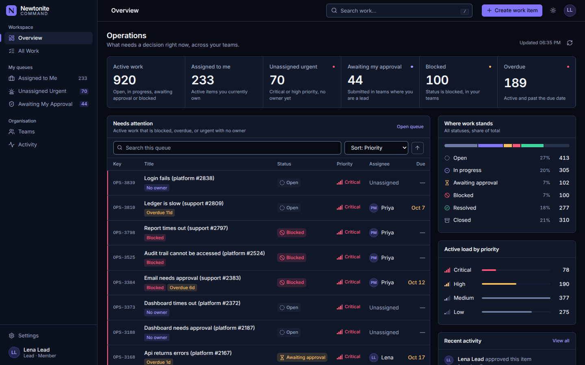

# NEWTONITE COMMAND — design system

*Operational intelligence, without the noise.* The interface is a quiet midnight surface where colour is reserved for meaning: violet marks brand and interaction, teal means done, amber means attention, coral means genuinely critical. Nothing is purple by default.

## Tokens (single source: `frontend/src/lib/tokens.ts`, mirrored in `src/index.css`)
| Token | Dark | Light | Use |
|---|---|---|---|
| bg / nav / surface / raised | `#080B14` `#0C1120` `#11182A` `#171F34` | `#F6F7FB` `#FFFFFF` `#FFFFFF` `#EEF0F7` | page, sidebar, cards, hover/inset |
| line / line-strong | `#27324B` / `#6B7A9E` | `#DDE1EE` / `#7C87A3` | hairlines / control borders |
| fg / muted | `#F5F7FF` / `#9AA8C4` | `#10162A` / `#4F5A78` | text |
| accent / accent-hi / accent-fg | `#8175FF` `#A69CFF` `#080B14` | `#5B4FE0` `#4A3EC9` `#FFFFFF` | fills, text-on-dark accent, label on accent fill |
| ok / warn / crit | `#3AD6A0` `#F6BD60` `#FF5578` | `#0A7452` `#8A5A00` `#B80E33` | resolved / attention / critical |

The dark palette is exactly the one in the brief (it passed every contrast check unchanged). Light-theme semantic colours were darkened until axe and the unit test passed.

## Command interface
The sign-in route uses a layered midnight canvas, a restrained orbital mark, and a focused workspace panel. At wide desktop sizes it balances a spacious story area with a 480–560px authentication card inside a fluid shell; compact viewports keep the form readable without scaling the page. A shared, lazily loaded Three.js scene carries the cosmic command-center atmosphere behind both sign-in and authenticated routes: a procedural shader orb, independently moving orbital paths, drifting low-count crystal and particle fields, and a reflective light-ring platform. The scene is decorative and hidden from assistive technology; it does not intercept input. Device-aware particle/geometry and pixel-ratio budgets, visibility pausing, resize handling, WebGL fallback art, and `prefers-reduced-motion` keep the effect bounded and optional. The form remains the primary focus, supports password reveal, and reports request failures without replacing the real API flow.

Authenticated pages share a refined, collapsible desktop navigation rail, breadcrumb header, account menu, and responsive drawer. The rail collapses to an icon strip without losing accessible labels; on mobile it remains a full-width drawer that closes on navigation, overlay activation, or `Esc`. The overview leads with an operational pulse: permission-scoped active work, status mix, and links into the existing status-filtered queues, followed by a compact connected metric index. The status ring and all counts come directly from `GET /dashboard/summary`; no trend or placeholder figures are presented as facts. Work rows and activity entries use generous, touch-friendly spacing, with timeline markers keyed to actual activity actions. The command palette is limited to real application destinations and the existing create-item action; `Ctrl+K` / `Cmd+K` opens it. Global work search remains available with `/`, and `Esc` closes the active menu, drawer, or dialog. Overview metrics and work states continue to use API data rather than presentation fixtures.

The Work constellation is a separately lazy-loaded Three.js scene fed by the existing team-scoped `GET /work-items` endpoint. Nodes are grouped by their actual status and use distinct shapes as well as accessible text labels in the list alternative; priority affects node scale. Search and status filtering remain server-side, older results load in API-sized pages, and selecting a node reveals the existing work-item link. The scene supports orbit, pan, zoom, reduced-motion rendering, lower device budgets, and a list fallback when WebGL is unavailable. It intentionally draws no item-to-item edges because the current schema exposes no dependency relationship. The assistant panel explicitly reports that no AI provider is configured; it does not simulate generated answers. The dashboard's attention queue remains based on the backend's observed blocked, overdue, and unassigned-urgent rules.

**Contrast (computed from the tokens, WCAG 2.x):** dark — body text 16.5:1, secondary 7.4:1, accent text 7.4:1, critical 5.7:1, control border 4.1:1; light — body 17.9:1, secondary 6.8:1, critical 6.7:1, control border 3.6:1. `src/test/tokens.test.ts` enforces AA (4.5:1) for text and 3:1 for control borders in both themes, and fails if `index.css` drifts from `tokens.ts`.

## Principles
* **Colour is never the only signal.** Every status has an icon + label; every priority has signal bars + label; critical rows add a thin edge, not a red wall.
* **Hierarchy through type, not decoration.** Inter (bundled via `@fontsource-variable/inter`, no network fonts), tabular numerals for every count, date and time, sentence-case labels, 13px table text.
* **A deliberate radius scale (6px controls, 8px surfaces, 12px feature cards), hairline borders, and restrained elevation.**
* **Motion explains, never decorates:** 150ms colour/press feedback, a 150ms dialog pop; everything is disabled under `prefers-reduced-motion`.
* **Layout follows available space:** the sidebar is persistent from 1024px and a drawer below; work tables choose columns with container queries, so the same table is correct in a 630px dashboard column, a full page and a 768px tablet.

## Components (`frontend/src/components/ui.tsx`)
Button · IconButton · Tip (tooltip) · Kbd · Card/CardHeader · Skeleton · StatusBadge · PriorityBars/PriorityBadge · Modal · Confirm · ErrorState · Empty · Field (label, required marker, hint, error) · Avatar · Logo. Plus `WorkTable`, `Feed` (activity timeline) and `AttentionQueue`.

## Metric definitions (all from `GET /dashboard/summary`, all scoped to the caller's teams)
Active work = open, in progress, awaiting approval or blocked · Critical + high = active items with either priority · Assigned to me = active items you own · Unassigned urgent = active, critical/high, no owner · Awaiting my approval = awaiting approval in teams where you are lead/admin · Blocked = status blocked · Overdue = active and past due. The status distribution includes all work item statuses. "Needs attention" = active AND (blocked OR overdue OR urgent-and-unowned), served by `GET /work-items?view=needs_attention` so search, sort and pagination are server-side.
