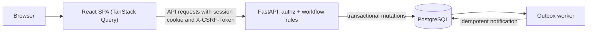

# Newtonite Ops — Operations Under Pressure

Internal work-management app that replaces chats, spreadsheets and email threads: create, assign, investigate, discuss and resolve operational work with clear ownership, an approval workflow and a trustworthy history. FastAPI + PostgreSQL backend, React SPA frontend, PostgreSQL-backed outbox worker.

## Features
Login/logout with cookie sessions · dashboard (assigned to me, unassigned urgent, awaiting my approval, blocked/overdue, status & priority distributions, recent items & activity) · All Work with server-side search/filter/sort/pagination · 3D work-item constellation with status/search filters, inspectable records, zoom/pan and an accessible list alternative · work-item detail with comments and activity timeline · claim/assign/reassign · lead-only approval workflow · stale-update (409) and double-claim (409) handling · idempotent creation · assignee-notification outbox job + worker · light/dark themes.

## Architecture / stack
See `ARCHITECTURE.md` (Mermaid diagram, transaction boundaries). Backend: Python 3.11+, FastAPI, Pydantic, SQLAlchemy 2, Alembic, PostgreSQL 16, pytest, HTTPX, argon2. Frontend: React 19, Vite, TypeScript, Tailwind 4, React Router, TanStack Query, React Hook Form, Zod, Lucide, and lazily loaded Three.js for the atmospheric and work-item scenes (shadcn/ui and Recharts were **not** used; components are small hand-written primitives and charts are CSS bars).



```
newtonite-ops/
  backend/  app/{api,worker,tests}  models.py schemas.py security.py authz.py seed.py maintenance.py main.py  alembic/  requirements.txt  .env.example
  frontend/ src/{lib,components,pages,test}  package.json  .env.example
  scripts/{make_zip.py,test.ps1}   docker-compose.yml   *.md
```

## Prerequisites
Python 3.11+, Node 20+ (built with Node 22 / npm 10), and PostgreSQL 16. Docker Desktop is the easiest local PostgreSQL option. The commands below use Windows PowerShell and assume each terminal starts in the cloned `newtonite-ops` repository root.

## Fresh-clone setup — Windows PowerShell
Start PostgreSQL from the repository root in Terminal 1:
```powershell
docker compose up -d db
```

In Terminal 2, prepare and start the backend:
```powershell
Set-Location .\backend
py -3.11 -m venv .venv
.\.venv\Scripts\Activate.ps1
python -m pip install -r requirements.txt
if (-not (Test-Path .env)) { Copy-Item .env.example .env }
# Review .env and set DATABASE_URL for your local PostgreSQL if it differs from Compose defaults.
alembic upgrade head
python -m app.seed
uvicorn app.main:app --reload --port 8000
```
The seed is development-only and does nothing once users exist; it does not update or reset a populated database. API docs: `http://localhost:8000/docs`.

In Terminal 3, start the worker (also from the repository root):
```powershell
Set-Location .\backend
.\.venv\Scripts\Activate.ps1
python -m app.worker
```
The worker polls every 2 seconds. `python -m app.worker --once` processes due jobs and exits.

In Terminal 4, install and start the frontend (from the repository root):
```powershell
Set-Location .\frontend
npm ci
npm run dev
```
Frontend URL: `http://localhost:5173`. Production build: `npm run build` (output in `frontend/dist`). The 3D scene renderer is lazy-loaded; the constellation has an accessible list alternative.

## Configuration
`backend/.env` (see `.env.example`): `DATABASE_URL`, `ENVIRONMENT` (`production` disables seeding and hides error details), `COOKIE_SECURE` (set `true` under HTTPS), `SESSION_HOURS`, `CORS_ORIGINS`. The Vite dev server proxies `/api` → `http://localhost:8000`, so the browser is same-origin and the HttpOnly `session` cookie (SameSite=Lax) just works; for a cross-origin deployment set `VITE_API_URL` and list the frontend origin in `CORS_ORIGINS` (credentials allowed; headers `Content-Type`, `X-CSRF-Token`, `Idempotency-Key`). `.env` files are ignored by `.gitignore`. Compose database credentials and the seed password are development-only and must not be reused in production.

Login email syntax is validated server-side. In non-production environments, reserved test domains such as `.test` are accepted so locally provisioned test accounts can authenticate; production retains email-validator's reserved-domain checks. Accepting a test-domain address does not create an account or bypass password verification.

## Tests
The backend suite drops and recreates every table in its target database. It refuses a database not named `*_test` and refuses the configured development database; use a dedicated, disposable test database only. With the Compose database running, create that database once from the repository root:
```powershell
docker compose exec db psql -U newtonite -d postgres -c "CREATE DATABASE newtonite_test"
```
After the backend virtual environment and frontend dependencies are installed and `newtonite_test` exists, run the complete suite and production build from the repository root:
```powershell
.\scripts\test.ps1
```
The script runs both backend test directories, frontend tests, and the production build. It uses `newtonite_test` by default, preserves an existing `TEST_DATABASE_URL`, and relies on the backend fixture to refuse the configured development database. To use another dedicated test database, set `$env:TEST_DATABASE_URL` before invoking it. Do not point it at a database containing development or production data.
Latest recorded results are in `KNOWN_LIMITATIONS.md`.

## Demo credentials (development only) — password `ChangeMe!Dev123`
| Email | Role |
|---|---|
| admin@newtonite.dev | global Admin |
| lead@newtonite.dev | Lead (Platform), Member (Support) |
| lead2@newtonite.dev | Lead (Payments, Compliance) |
| sam@ / priya@ / mia@ / noah@newtonite.dev | Members (priya is Lead of Support) |
| viewer@ / viewer2@newtonite.dev | Viewers |
| omar@newtonite.dev | Member (Compliance only — good for cross-team checks) |

## Permission matrix (enforced server-side, per team)
| Action | Viewer | Member | Lead | Admin |
|---|:-:|:-:|:-:|:-:|
| Read team items, comments, history | ✔ | ✔ | ✔ | ✔ |
| Create item, comment, claim an unassigned item for self | | ✔ | ✔ | ✔ |
| Edit title/description/priority/due | | creator or assignee | ✔ | ✔ |
| Move open ⇄ in_progress ⇄ blocked, submit for approval | | assignee only | ✔ | ✔ |
| Assign to others, reassign, unassign | | | ✔ | ✔ |
| Approve (→ resolved), request changes, close, reopen | | | ✔ | ✔ |
Global `is_admin` users are Admin in every team. Users outside an item's team get **404** (existence concealed); insufficient role gets **403**.

## Workflow
`open → in_progress → awaiting_approval → resolved → closed`, with `blocked` (from open/in_progress, back to open/in_progress). `awaiting_approval → in_progress` = changes requested (lead). `resolved → closed | open | in_progress` and `closed → open` are reopen/close (lead). Anything else returns **422 invalid_transition** with the allowed list; a Member can never mark an item resolved.

## API (`/api/v1`, OpenAPI at `/docs`)
`POST /auth/login` · `POST /auth/logout` · `GET /auth/me` (login/me return `csrf_token`; send it as `X-CSRF-Token` on every non-GET) ·
`GET /work-items` (q, status[], priority[], type[], team_id, assignee=id|me|unassigned, overdue, `view`=assigned_to_me|unassigned_urgent|awaiting_my_approval|needs_attention, sort, order, page, page_size≤100) · `POST /work-items` (`Idempotency-Key`) · `GET|PATCH /work-items/{id}` (`expected_version`) · `POST /work-items/{id}/assign` (no version = claim; with `expected_version` = reassign/unassign) · `POST …/transition` · `GET|POST …/comments` · `GET …/activity` ·
`GET /dashboard/summary` (counts, distributions, recently updated, recent activity incl. `work_item_key`) · `GET /dashboard/attention` (kept for API clients; the UI uses `view=needs_attention` instead) · `GET /teams` · `GET /users?team_id=`.
Errors: `{"error":{"code","message","details"}}`. 409 bodies include `details.current` (the latest item). Idempotency: scope = (user, key), retained 24 h; same payload → original result (HTTP 200, `Idempotent-Replay: true`); different payload → 409 `idempotency_key_reuse`.

## Interface & design system
The UI is **NEWTONITE COMMAND**: see `DESIGN.md` (tokens, contrast ratios, principles, metric definitions) and `docs/screenshots/`. Pages: Login, Overview, All Work, Work constellation, Assigned to Me, Unassigned Urgent, Awaiting My Approval, Needs Attention (`/attention`, linked from Overview), Work item, Teams, Activity, Settings. The constellation queries real, permission-scoped work items and provides a server-side search/status filter, selectable 3D nodes, paging, and an accessible list view. The API currently has no workflow entity or dependency relation, so no graph edges are implied or drawn. No AI provider is configured; the interface reports the copilot unavailable rather than presenting generated analysis. Keyboard: `/` focuses work search, `Ctrl+K` / `Cmd+K` opens the command palette, and `Esc` closes dialogs, menus, and the palette.

## Optional real-browser checks (`scripts/browser/`)
```powershell
cd scripts/browser ; npm install                     # puppeteer-core, axe-core, @sparticuz/chromium (Linux Chromium)
$env:CHROME_PATH = "C:\Program Files\Google\Chrome\Application\chrome.exe"   # use a local Chrome instead (Windows path: untested)
# app must be running at http://127.0.0.1:5173 (npm run dev -- --host 127.0.0.1) on a freshly seeded database
node e2e.mjs                                          # claim race, stale edit + retry, double-submit, lead-only approval (mutates dev data: reseed afterwards)
node a11y.mjs                                         # axe-core audit of every page in both themes + keyboard checks
$env:W = "tablet" ; node screenshots.mjs out / /work  # screenshots + horizontal-overflow check (one width per run; W = desktop|laptop|tablet|mobile)
```

## Troubleshooting
* Tests fail to connect → start PostgreSQL and create `newtonite_test`; override with `TEST_DATABASE_URL` (its database name must end in `_test`).
* `pip install` fails building psycopg → `requirements.txt` uses `psycopg[binary]`; make sure you installed from that file with a supported Python (3.11+).
* Login works but writes return 403 `csrf_failed` → client must send the `csrf_token` from login/me as `X-CSRF-Token`.
* Cookie not stored over HTTPS-less cross-origin → use the Vite proxy (default) or serve both over HTTPS with `COOKIE_SECURE=true`.
* `alembic upgrade` complains about existing tables → use an empty database.

## Known limitations
See `KNOWN_LIMITATIONS.md` and `ENGINEERING_DECISIONS.md`.
