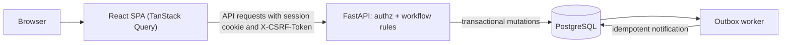

# Newtonite Ops — Operations Under Pressure

Internal work-management app that replaces chats, spreadsheets and email threads: create, assign, investigate, discuss and resolve operational work with clear ownership, an approval workflow and a trustworthy history. FastAPI + PostgreSQL backend, React SPA frontend, PostgreSQL-backed outbox worker.

## Features
Login/logout with cookie sessions · dashboard (assigned to me, unassigned urgent, awaiting my approval, blocked/overdue, status & priority distributions, recent items & activity) · All Work with server-side search/filter/sort/pagination · 3D work-item constellation with status/search filters, inspectable records, zoom/pan and an accessible list alternative · work-item detail with comments and activity timeline · claim/assign/reassign · lead-only approval workflow · stale-update (409) and double-claim (409) handling · idempotent creation · assignee-notification outbox job + worker · light/dark themes.

## Architecture / stack
See `ARCHITECTURE.md` (Mermaid diagram, transaction boundaries). Backend: Python 3.11+, FastAPI, Pydantic, SQLAlchemy 2, Alembic, PostgreSQL 16, pytest, HTTPX, argon2. Frontend: React 19, Vite, TypeScript, Tailwind 4, React Router, TanStack Query, React Hook Form, Zod, Lucide, and lazily loaded Three.js for the atmospheric and work-item scenes (shadcn/ui and Recharts were **not** used; components are small hand-written primitives and charts are CSS bars).



```
newtonite-ops/
  backend/  app/{api,worker,tests}  models.py schemas.py security.py authz.py seed.py maintenance.py main.py  alembic/  requirements.txt  .env.example
  frontend/ src/{lib,components,pages,test}  package.json  .env.example
  scripts/{make_zip.py,test.ps1}   docker-compose.yml   *.md
```

## Run Locally on Windows

These instructions are for Windows 10/11, VS Code, and PowerShell. Run commands marked **once** only at the indicated setup step; leave each **running** service in its own terminal until you stop it. The commands use the repository root (the `newtonite-ops` folder) unless a `Set-Location` changes it.

### 1. Prerequisites

Install:

- **Python 3.11 or newer** (the Python launcher `py` is recommended).
- **Node.js 20 or newer**, which includes npm. This project has also been built with Node 22 and npm 10.
- **Git**.
- **Docker Desktop** for Windows, with its Linux container engine running. Docker Compose is included with current Docker Desktop versions.
- **Visual Studio Code**.

Open PowerShell and verify the tools are available:

```powershell
py --version
node --version
npm --version
git --version
docker --version
docker compose version
code --version
```

Python should report 3.11 or newer, and Node.js should report 20 or newer. If `py` is unavailable but `python --version` reports a supported version, use `python` in place of `py -3.11` below. `code --version` is only needed for the convenient VS Code command-line launch; VS Code can also be opened from the Start menu.

### 2. Clone the repository and open it in VS Code

**Once**, in a PowerShell terminal in the directory where you keep projects:

```powershell
git clone https://github.com/siddharth182005-dotcom/newtonite-ops.git
Set-Location .\newtonite-ops
code .
```

Open four integrated PowerShell terminals in VS Code (**Terminal > New Terminal**). They should start in the repository root. Verify with `Get-Location`; if a terminal is elsewhere, open a new terminal from the Newtonite Ops workspace rather than guessing or typing a placeholder path.

### 3. Terminal 1: PostgreSQL/Docker

Start Docker Desktop first and wait until its engine is running. From the repository root, run this **once per start**; PostgreSQL then stays running in Docker in the background:

```powershell
docker compose up -d db
docker compose ps
```

The Compose service is PostgreSQL 16 on port `5432`, with a persistent named volume (`pgdata`). Wait for the `db` service health status to become `healthy` before continuing. If it is not healthy, inspect `docker compose logs --tail 50 db`. This project uses the Compose development database; do not remove its volume to troubleshoot.

### 4. Terminal 2: Backend environment, migrations, and API

From the repository root, create and activate the backend virtual environment. These are **one-time setup** commands for a fresh clone:

```powershell
Set-Location .\backend
py -3.11 -m venv .venv
.\.venv\Scripts\Activate.ps1
python -m pip install -r requirements.txt
```

If the virtual environment already exists, do not recreate it; activate it and continue. Copy the example configuration only if you do not already have a local `.env`:

```powershell
if (-not (Test-Path .env)) { Copy-Item .env.example .env }
```

Keep any existing `.env` intact. The backend reads these variables from `backend/.env`:

| Variable | Local development setting |
|---|---|
| `DATABASE_URL` | PostgreSQL connection URL for the Compose database (`localhost:5432/newtonite`, user `newtonite`) |
| `ENVIRONMENT` | `development` |
| `COOKIE_SECURE` | `false` for local HTTP |
| `SESSION_HOURS` | `8` |
| `CORS_ORIGINS` | `http://localhost:5173` |

The safe development values are in [`backend/.env.example`](backend/.env.example). They are for local development only; never reuse development credentials in production or put real secrets in a committed file.

Apply migrations with this command **once for a new or pending schema**, from `backend` with the virtual environment active:

```powershell
alembic upgrade head
```

Migrations update the schema and do not reset application data. If this database already contains application tables but has no matching Alembic revision, stop and inspect the database state rather than deleting tables or switching to a blank database.

Seed only a new, empty development database. After migrations, the seed command refuses production and exits without making changes if any users already exist; it does not update or repair accounts. Never drop, reset, or reseed a database that contains development data:

```powershell
python -m app.seed
```

Start the API **after setup**, and leave this terminal running:

```powershell
uvicorn app.main:app --reload --port 8000
```

API base URL: `http://localhost:8000` · Health check: `http://localhost:8000/healthz` · Interactive API docs: `http://localhost:8000/docs`.

### 5. Terminal 3: Frontend

From the repository root, install the exact locked frontend dependencies **once for a fresh clone**, then start Vite and leave the terminal running:

```powershell
Set-Location .\frontend
npm ci
npm run dev
```

Vite serves the application at `http://localhost:5173`; the login page is `http://localhost:5173/login`. In development, Vite proxies `/api` to `http://localhost:8000`, so leave `VITE_API_URL` empty in `frontend/.env.example` for the same-origin session-cookie flow. A frontend `.env` is not required for this local setup.

### 6. Terminal 4: Worker (recommended)

The API and UI can start without the worker, but queued outbox notifications will not be processed until it runs. To process them, open another terminal and run from the repository root:

```powershell
Set-Location .\backend
.\.venv\Scripts\Activate.ps1
python -m app.worker
```

Leave this terminal running. The worker polls for due jobs approximately every two seconds. To process due jobs once and exit instead, run `python -m app.worker --once`.

### Quick-start checklist

- [ ] Docker Desktop is running and `docker compose ps` shows PostgreSQL healthy.
- [ ] Backend virtual environment is active and dependencies are installed.
- [ ] `backend/.env` exists and points to the intended local database; any existing `.env` was preserved.
- [ ] Alembic migrations are current; seed was run only if this is a new, empty development database.
- [ ] Backend is running at `http://localhost:8000`.
- [ ] Frontend is running at `http://localhost:5173`; sign in at `/login`.
- [ ] Worker is running if queued notifications should be processed.

### Local service URLs

| Service | URL | Notes |
|---|---|---|
| Frontend | `http://localhost:5173` | Login: `http://localhost:5173/login` |
| Backend health | `http://localhost:8000/healthz` | Returns API health status |
| API documentation | `http://localhost:8000/docs` | FastAPI interactive docs |
| PostgreSQL | `localhost:5432` | Available to local tools; not an HTTP page |

### Demo login

The seeded development admin is `admin@newtonite.dev` with the development-only password shown in the Demo credentials section below. This account is available only if the demo seed data was created in this database; the seed command does not create or repair accounts in a database that already has users. Do not use these credentials outside local development.

### Stop the application

In Terminals 2, 3, and 4, press **Ctrl+C** to stop the API, Vite, and worker processes. PostgreSQL is a Docker service running in the background; from the repository root, stop it without deleting its data:

```powershell
docker compose stop db
```

If you also want to remove the stopped Compose container and network, `docker compose down` preserves the named database volume. **Never add `-v`** if you want to keep the PostgreSQL data.

The production frontend build is `npm run build` from `frontend` (output in `frontend/dist`). The 3D scene renderer is lazy-loaded; the constellation has an accessible list alternative.

## Configuration
`backend/.env` (see `.env.example`): `DATABASE_URL`, `ENVIRONMENT` (`production` disables seeding and hides error details), `COOKIE_SECURE` (set `true` under HTTPS), `SESSION_HOURS`, `CORS_ORIGINS`. The Vite dev server proxies `/api` → `http://localhost:8000`, so the browser is same-origin and the HttpOnly `session` cookie (SameSite=Lax) just works; for a cross-origin deployment set `VITE_API_URL` and list the frontend origin in `CORS_ORIGINS` (credentials allowed; headers `Content-Type`, `X-CSRF-Token`, `Idempotency-Key`). `.env` files are ignored by `.gitignore`. Compose database credentials and the seed password are development-only and must not be reused in production.

Login email syntax is validated server-side. In non-production environments, reserved test domains such as `.test` are accepted so locally provisioned test accounts can authenticate; production retains email-validator's reserved-domain checks. Accepting a test-domain address does not create an account or bypass password verification.

## Tests
The backend suite drops and recreates every table in its target database. It refuses a database not named `*_test` and refuses the configured development database. Use only a dedicated, disposable test database; never point tests at a development or production database.

With the Compose database running, first check whether `newtonite_test` already exists:
```powershell
docker compose exec db psql -U newtonite -d postgres -c "\l"
```
Only if it does not exist, create it once:
```powershell
docker compose exec db psql -U newtonite -d postgres -c "CREATE DATABASE newtonite_test"
```
After the backend virtual environment and frontend dependencies are installed and the dedicated `newtonite_test` database exists, run the complete suite and production build from the repository root:
```powershell
.\scripts\test.ps1
```
The script runs both backend test directories, frontend tests, and the production build. It uses `newtonite_test` by default and preserves an existing `TEST_DATABASE_URL`. The backend fixture checks that the target database name ends in `_test` and is not the configured development database. To use another dedicated test database, set `$env:TEST_DATABASE_URL` before invoking it. These tests are destructive to their target database; never point them at a database containing development or production data.

To run individual checks instead, first ensure the isolated test database exists. Run backend tests from `backend` with its virtual environment active, frontend tests from `frontend`, and the production build from `frontend`:
```powershell
# Backend (from backend; TEST_DATABASE_URL must target a disposable *_test database)
python -m pytest -q app/tests tests

# Frontend tests and production build (from frontend)
npm test
npm run build
```
Latest recorded results are in `KNOWN_LIMITATIONS.md`.

## Demo credentials (development only) — password `ChangeMe!Dev123`
| Email | Role |
|---|---|
| admin@newtonite.dev | global Admin |
| lead@newtonite.dev | Lead (Platform), Member (Support) |
| lead2@newtonite.dev | Lead (Payments, Compliance) |
| sam@ / priya@ / mia@ / noah@newtonite.dev | Members (priya is Lead of Support) |
| viewer@ / viewer2@newtonite.dev | Viewers |
| omar@newtonite.dev | Member (Compliance only — good for cross-team checks) |

## Permission matrix (enforced server-side, per team)
| Action | Viewer | Member | Lead | Admin |
|---|:-:|:-:|:-:|:-:|
| Read team items, comments, history | ✔ | ✔ | ✔ | ✔ |
| Create item, comment, claim an unassigned item for self | | ✔ | ✔ | ✔ |
| Edit title/description/priority/due | | creator or assignee | ✔ | ✔ |
| Move open ⇄ in_progress ⇄ blocked, submit for approval | | assignee only | ✔ | ✔ |
| Assign to others, reassign, unassign | | | ✔ | ✔ |
| Approve (→ resolved), request changes, close, reopen | | | ✔ | ✔ |
Global `is_admin` users are Admin in every team. Users outside an item's team get **404** (existence concealed); insufficient role gets **403**.

## Workflow
`open → in_progress → awaiting_approval → resolved → closed`, with `blocked` (from open/in_progress, back to open/in_progress). `awaiting_approval → in_progress` = changes requested (lead). `resolved → closed | open | in_progress` and `closed → open` are reopen/close (lead). Anything else returns **422 invalid_transition** with the allowed list; a Member can never mark an item resolved.

## API (`/api/v1`, OpenAPI at `/docs`)
`POST /auth/login` · `POST /auth/logout` · `GET /auth/me` (login/me return `csrf_token`; send it as `X-CSRF-Token` on every non-GET) ·
`GET /work-items` (q, status[], priority[], type[], team_id, assignee=id|me|unassigned, overdue, `view`=assigned_to_me|unassigned_urgent|awaiting_my_approval|needs_attention, sort, order, page, page_size≤100) · `POST /work-items` (`Idempotency-Key`) · `GET|PATCH /work-items/{id}` (`expected_version`) · `POST /work-items/{id}/assign` (no version = claim; with `expected_version` = reassign/unassign) · `POST …/transition` · `GET|POST …/comments` · `GET …/activity` ·
`GET /dashboard/summary` (counts, distributions, recently updated, recent activity incl. `work_item_key`) · `GET /dashboard/attention` (kept for API clients; the UI uses `view=needs_attention` instead) · `GET /teams` · `GET /users?team_id=`.
Errors: `{"error":{"code","message","details"}}`. 409 bodies include `details.current` (the latest item). Idempotency: scope = (user, key), retained 24 h; same payload → original result (HTTP 200, `Idempotent-Replay: true`); different payload → 409 `idempotency_key_reuse`.

## Interface & design system
The UI is **NEWTONITE COMMAND**: see `DESIGN.md` (tokens, contrast ratios, principles, metric definitions) and `docs/screenshots/`. Pages: Login, Overview, All Work, Work constellation, Assigned to Me, Unassigned Urgent, Awaiting My Approval, Needs Attention (`/attention`, linked from Overview), Work item, Teams, Activity, Settings. The constellation queries real, permission-scoped work items and provides a server-side search/status filter, selectable 3D nodes, paging, and an accessible list view. The API currently has no workflow entity or dependency relation, so no graph edges are implied or drawn. No AI provider is configured; the interface reports the copilot unavailable rather than presenting generated analysis. Keyboard: `/` focuses work search, `Ctrl+K` / `Cmd+K` opens the command palette, and `Esc` closes dialogs, menus, and the palette.

## Optional real-browser checks (`scripts/browser/`)
```powershell
cd scripts/browser ; npm install                     # puppeteer-core, axe-core, @sparticuz/chromium (Linux Chromium)
$env:CHROME_PATH = "C:\Program Files\Google\Chrome\Application\chrome.exe"   # use a local Chrome instead (Windows path: untested)
# app must be running at http://127.0.0.1:5173 (npm run dev -- --host 127.0.0.1) on a freshly seeded database
node e2e.mjs                                          # claim race, stale edit + retry, double-submit, lead-only approval (mutates dev data: reseed afterwards)
node a11y.mjs                                         # axe-core audit of every page in both themes + keyboard checks
$env:W = "tablet" ; node screenshots.mjs out / /work  # screenshots + horizontal-overflow check (one width per run; W = desktop|laptop|tablet|mobile)
```

## Troubleshooting
* **Port already in use:** the local services use PostgreSQL `5432`, API `8000`, and Vite `5173`. Stop the process that owns the conflicting port or configure that service and its dependent settings consistently. If changing the Vite origin, update backend `CORS_ORIGINS` to match it; the default `/api` proxy assumes the backend is at `http://localhost:8000`.
* **Database connection failure:** ensure Docker Desktop is running and `docker compose ps` reports `db` healthy. Review `docker compose logs --tail 50 db`; check that `backend/.env` has a `DATABASE_URL` matching the Compose port, database name, username, and password. Do not remove the `pgdata` volume to resolve connection issues.
* **Missing environment values:** run backend commands from `backend` so the application loads `backend/.env`. If it does not exist, create it from `.env.example` only; do not replace an existing `.env`. The frontend needs no `.env` for the default Vite proxy; leave `VITE_API_URL` blank.
* **PowerShell blocks virtual-environment activation:** in the current terminal only, run `Set-ExecutionPolicy -Scope Process -ExecutionPolicy Bypass`, then retry `.\.venv\Scripts\Activate.ps1`. This does not change the machine-wide execution policy. Alternatively, invoke the environment's Python directly at `.\.venv\Scripts\python.exe`.
* **CORS or session-cookie errors:** use the default `http://localhost:5173` Vite URL and its `/api` proxy to `http://localhost:8000`. If using a different frontend origin, set `CORS_ORIGINS` to that exact origin and restart the API. Login/me return a `csrf_token`; the client must send it as `X-CSRF-Token` on non-GET requests.
* **Dependency installation fails:** use Python 3.11+ and install backend requirements from `backend` with `python -m pip install -r requirements.txt`. Use Node.js 20+ and run `npm ci` from `frontend`; if installation is interrupted, rerun `npm ci` and review the first reported network or package error.
* **Tests cannot connect:** start PostgreSQL and create the isolated `newtonite_test` database as described under Tests. If using `TEST_DATABASE_URL`, its database name must end in `_test` and must not be the configured development database.
* **`alembic upgrade head` reports existing tables:** stop and inspect whether the database was previously initialized and whether it has an Alembic revision. Do not drop tables, reset, or switch away from existing development data as a workaround.

## Known limitations
See `KNOWN_LIMITATIONS.md` and `ENGINEERING_DECISIONS.md`.
